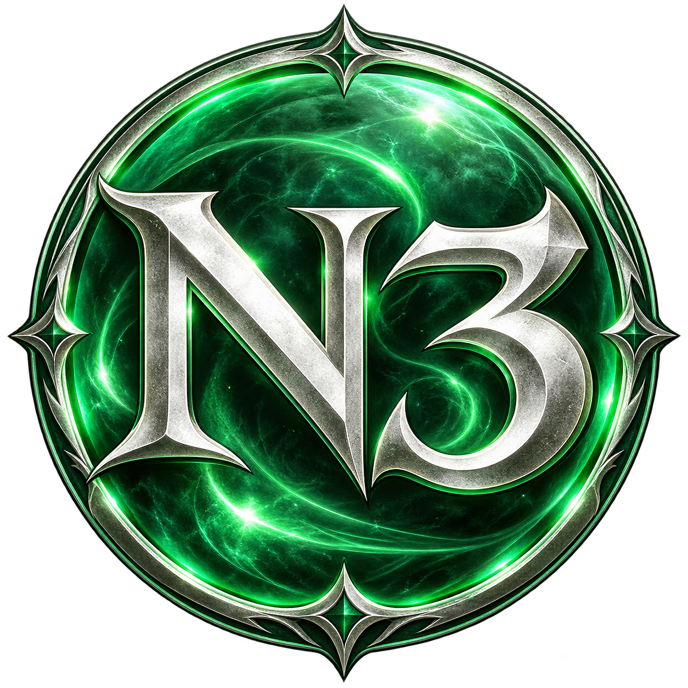

# N3 Recompiled



A native Windows recompilation project for **N3: Ninety-Nine Nights**, built from
the Xbox 360 executable with [ReXGlue](https://github.com/rexglue/rexglue-sdk).
PowerPC game code is translated to C++ ahead of time. ReXGlue supplies the Xbox
runtime and its Xenos GPU plugin uses Direct3D 12.

**Windows alpha:** the opening mission has been completed, the following
cutscene played, and saving and loading progress work on the tested opening route.
Full-game coverage remains unvalidated. See [development status](docs/STATUS.md).

No game assets, original executable, generated game translations, or downloaded
toolchain binaries are tracked. Supply your own game data. The supported executable
is identified in [game-build.json](docs/game-build.json).

## Play the Windows alpha

**[Download for Windows (x64)](https://github.com/WK2D/N3-Ninety-Nine-Nights-Recomp/releases/download/v0.1.0-alpha.4/N3-Recompiled-v0.1.0-alpha.4-windows-x64.zip)**

Extract the whole ZIP and run **n3.exe**. Select an ISO made from your own
disc, or `default.xex` in your own extracted game folder with `data/` beside it.
Setup checks the executable's SHA-256 and remembers the local folder. Importing
an ISO needs about 5.8 GB of free space; the original image stays unchanged.

The supported USA/Europe executable is version **0.0.0.3**. Other revisions are
rejected. Windows 10/11 x64, Direct3D 12, and an Xbox-compatible controller are
the current target. No Node.js, Python, or build tools are needed to play.

The app defaults to a **1280 x 720 window**. Saves, settings, imported data,
caches, and logs default to `%LOCALAPPDATA%\N3Recompiled`. Keep this profile
folder when updating; replace the application folder with the new release.
An existing extracted game folder is linked in place. The package contains
no game assets or original executable. See the [release guide](docs/RELEASE-README.txt).

[Release notes, checksums, and optional developer sources](https://github.com/WK2D/N3-Ninety-Nine-Nights-Recomp/releases/tag/v0.1.0-alpha.4)
are available separately. Only the Windows ZIP is needed to play.

The emerald N3 icon is embedded in `n3.exe` and appears on the application window
and Windows shortcuts made from it. To add a desktop shortcut, right-click
`n3.exe`, choose **Show more options** on Windows 11, then **Send to → Desktop
(create shortcut)**. Keep the extracted application folder in its chosen location.

## Run a development build

Double-click **N3 Recompiled** on the desktop, or run:

```powershell
pwsh -NoProfile -File tools/launch.ps1
```

The launcher defaults to a **1280 x 720 window**, keeps fullscreen off, and stores saves,
profile data, and caches under `private/`. Runtime logs go under `logs/`.
The shortcut follows the stable launcher and build path, so rebuilding updates
what it launches. Refresh the shortcut after moving the project folder:

```powershell
pwsh -NoProfile -File tools/install-shortcut.ps1
```

## Graphics

Select **Graphics** below **Tutorial** on the main menu. This opens a separate
page using the game's Options layout, fonts, arrows, and controller navigation.
Use up/down to select a row and left/right to change its value. **B** returns.
Changes apply immediately and are saved to the local profile.

- **Frame rate:** 30, 40, or 60 FPS; 30 is the default.
- **Anisotropic filtering:** Game default, Off, 2x, 4x, 8x, or 16x.
- **Display resolution:** 720p, 1080p, 1440p, or 4K window/output size.
- **Render resolution:** 720p (1x), 1440p (2x), or 4K (3x) internal rendering.
- **VSync:** On or Off, applied live to Windows presentation.
  On synchronizes presentation without blocking menu input; Off allows tearing
  when supported. This is separate from the game's vblank clock.

Filtering overrides apply to eligible mipmapped textures. The renderer retains
the game's filtering for textures outside that policy. The original Options
page continues to provide the existing audio, camera, vibration, and contrast
settings. No restart is needed for the Graphics controls. Render changes rebuild
the scale-dependent GPU caches at a completed frame boundary; a brief pause while
resources and shaders are prepared is possible. Unsupported changes retain the
previous render scale. A short confirmation reports when settings are saved.

Display size and internal rendering are independent. The app restores
maximized/fullscreen windows when a display preset is selected and apply exact
physical client dimensions. A large window can extend beyond the desktop when
its client size plus borders will not fit. The renderer supports
integer scales, so 1080p is available as a display size, with 720p/1440p/4K render
choices. Saved display settings apply on the next launch; explicit launcher
`-Width`/`-Height` arguments override them for that launch.

The new menu is derived locally from the player's own data into the profile's
`ui/` cache. Original game files are read only; no menu assets are bundled.

For a single launch, development overrides remain available:

```powershell
pwsh -NoProfile -File tools/launch.ps1 -FrameRate 30
pwsh -NoProfile -File tools/launch.ps1 -FrameRate 40
pwsh -NoProfile -File tools/launch.ps1 -FrameRate 60
pwsh -NoProfile -File tools/launch.ps1 -FrameRate Original
```

**Development caveat:** higher frame-rate modes remain experimental. Initial
60 FPS testing is smooth, but animations appear accelerated. Animation/combat
timing is still under investigation; a requested limit does not guarantee that
all scenes achieve it. Movie/audio clocks remain unchanged and prerecorded
videos can retain their original rate. Use the Original override for timing
comparisons against unmodified game pacing. The Graphics menu was introduced in alpha 2; VSync and the audit corrections are included from alpha 3.

## Build from a fresh checkout

Windows x64 is the platform tested so far. Setup needs PowerShell 7, Node.js 18+
for disc extraction, Python 3.10+ for portable Microsoft tools, and 7-Zip for
unpacking the LLVM installer. Setup extracts tools locally; it does not install
Visual Studio globally. Download sizes total roughly 1 GB, plus extracted tools
and approximately 5.8 GB of game files.

```powershell
# AcceptVisualStudioLicense accepts Microsoft's development-tool licence.
pwsh -NoProfile -File tools/bootstrap.ps1 -AcceptVisualStudioLicense -Python python

node tools/disc.mjs extract "path/to/your-disc.iso" private/game private/disc-manifest.json
pwsh -NoProfile -File tools/build.ps1
pwsh -NoProfile -File tools/launch.ps1
```

Alternatively, supply an existing VS 2022 x64 development environment and use
`bootstrap.ps1 -ToolsOnly`. Tool versions, download URLs, and archive checksums
are in [toolchain.lock.json](tools/toolchain.lock.json). The Microsoft downloader
pins VS 2022 / MSVC 14.44 / Windows SDK 26100; Microsoft's servicing manifests can
update the patch versions within those selections.

Extraction refuses an existing output directory. Each extracted file receives
a SHA-256 hash in the local disc manifest. Build/codegen verifies the expected
`default.xex` hash before using the build-specific function hints.

## Development commands

```powershell
node --test tools/disc.test.mjs
pwsh -NoProfile -File tools/codegen.ps1 -Regenerate
pwsh -NoProfile -File tools/build.ps1 -Configuration RelWithDebInfo -Jobs 4
pwsh -NoProfile -File tools/smoke.ps1 -Seconds 30
pwsh -NoProfile -File tools/symbolize-fault.ps1
```

The build runs native clock, callback floating-point, disc importer, game-path,
crash-report, frame-rate, menu-layout, profile persistence, and host presentation regression tests. The Xenos GPU
plugin is rebuilt from the pinned SDK source with the local live-resolution
extension in `tools/gpu/`. The first build downloads the corresponding SDK sources
when necessary; `-Python` selects the Python executable for preparation.
For an isolated developer profile, `--graphics_audit --graphics_trace
--frame_pacing_trace` cycles controls without saving. After at least 50 seconds,
`python tools/verify-graphics-audit.py path/to/the-log` checks actual window,
render-source, sampler, and presentation evidence. Use a separate test profile;
the probe deliberately changes live settings. Prerecorded videos retain their
own frame rate, so gameplay pacing needs a separate check.
Smoke tests stop
their own child process at the deadline and record the result under `logs/`;
survival alone does not establish correct rendering or gameplay. Smoke runs use
the same local profile as the launcher, so use separate profile copies for future
save regression testing.

FP fault reports live in the active profile's `logs/` folder and contain module
basenames and offsets. The symbolizer defaults to the local RelWithDebInfo build;
pass `-Executable` when resolving a report against a different binary/PDB.

Analysis hints belong in `n3_manifest.toml`, and runtime fixes belong in `src/`.
Do not hand-edit generated translations. `generated/rexglue.cmake` is SDK build
integration boilerplate and is the only tracked file in `generated/`.

For a Windows release, build the `Release` configuration, run
`python tools/bundle-sdk-source.py`, then `python tools/package-release.py`.
The packaging tool admits an explicit set of runtime files, carries third-party
notices, scans binaries for local identifiers, and writes ZIP checksums under
`out/release/`. Inspect and test that package before publishing.

## References

The [native engine module notes](docs/NATIVE-CODE.md) describe the typed frame
clock, guest-memory boundary, and comparisons against the translated game code.

The next platform work targets Vulkan and Apple Silicon. Portable native
components can already build without game data or the Xbox runtime; the full
game remains Windows-only. See the [native code and porting roadmap](docs/PORTING.md).

[LostOdysseyRecomp](https://github.com/freefrank/LostOdysseyRecomp) and
[UnleashedRecomp](https://github.com/hedge-dev/UnleashedRecomp) are the reference
projects for development practices and the longer-term port experience.
See [reference notes](docs/REFERENCES.md) and [third-party notices](THIRD_PARTY.md).
